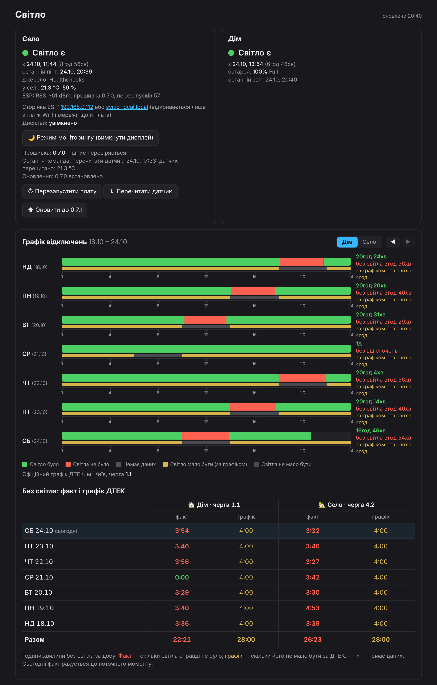

# Svitlo-Local — blackout monitoring with no open ports

Self-hosted power-outage monitoring for two locations — **a village** (ESP8266 in a socket) and **home** (a Proxmox laptop) — without relying on a third-party "is there light" service. Clean-room implementation from my own specification.

## How it works

```
 VILLAGE                          INTERNET                        VPS
 ESP8266 ──HTTPS ping 1/min──▶ hc-ping.com (Healthchecks) ◀──polls API 1/min── svitlo-poller ─┐
 (same socket as the router)                                                                  ├─ SQLite
                                                                               svitlo-web ◀────┘
 HOME                                                                          10.0.0.1:3003
 pve laptop: power-guard ──POST /api/power every 30 s── WireGuard (10.0.0.1 only) ──▶ (WG only)
```

- **No new port is opened anywhere.** The ESP and the laptop only make outbound connections; the dashboard listens on the VPS's WireGuard address only.
- **Village:** there is power as long as the ESP is alive and pinging. No pings for more than 3 minutes → "no signal, probably no power".
- **Home:** `power-guard` on the Proxmox host reads the AC adapter and battery state, sleeps and shuts down on low battery.

## Repository layout

| Directory | What it is |
|---|---|
| `server/` | Web app and poller (Python, FastAPI, SQLite) in Docker Compose on a VPS |
| `power-guard/` | Service for the Proxmox host: tracks AC and battery, sleeps, shuts down when drained |
| `firmware/` | NodeMCU (ESP8266) firmware: pinging, captive portal, LCD, BME280, DS3231 |
| `tools/emulator.py` | ESP and power-guard emulator for testing without hardware |
| `tools/lcd_preview.py` | LCD 1602 screen images rendered straight from `display.cpp` |
| `docs/` | Pictures: LCD screens, board pages, dashboard |
| `tests/` | Unit tests for the state machines and the API |

The dashboard card view, with the DTEK outage schedule overlaid:



More screenshots: [village week](docs/dashboard/02-village-week.png), [remote board control](docs/dashboard/03-esp-remote-control.png), [village offline](docs/dashboard/05-village-offline.png), [home server asleep](docs/dashboard/06-home-sleeping.png), [mobile 390 px](docs/dashboard/09-mobile.png).

## Install

### 1. Server on the VPS
1. Copy `server/` to `~/svitlo-local` on the VPS.
2. `cp .env.example .env && chmod 600 .env` and fill in the fields (documented inside the file).
3. `docker compose up -d --build`

**Done when** `curl http://10.0.0.1:3003/api/status` through WireGuard returns JSON. Nightly backups run at 04:30 via cron (14 copies kept).

### 2. WireGuard pve → VPS
Keys and config for the laptop peer, `AllowedIPs = 10.0.0.1/32`; only the VPS goes through the tunnel.

### 3. power-guard on the Proxmox host
`./install.sh` as root, put the token into `/etc/power-guard.conf` (the VPS stores only its sha256). **Done when** the dashboard shows "Home: power on" with a battery percentage.

### 4. ESP8266 firmware
Built and flashed with PlatformIO, over USB or OTA (`secrets.ini` is git-ignored). Firmware 0.7.0 has an LCD 1602 UI (clock, room climate, weather forecast), a configuration web page, OTA updates and remote commands from the dashboard.

## Honest gaps — what the system cannot tell apart

No pings from the village while the server is up can mean: (a) no power, (b) power is on but the internet or the router is down, (c) the ESP hung. So the dashboard says "No signal — probably no power", never "definitely no power".

What helps:
- the ESP sends its own `uptime_s` in the ping body. If after an outage the ESP did **not** reboot (uptime larger than the gap), the power was on all along — only connectivity was lost;
- the true moment power returned is the first ping's time minus `uptime_s`, which compensates for the 1–2 minute router boot;
- when data may have been lost, the period is marked **"unknown"**, never counted as an outage.

## Tests and diagnostics

```
cd tests
python -m unittest
```

Troubleshooting table (poller logs, `journalctl -u power-guard`, `wg show`) is in the Ukrainian section of this README.

## Security notes

The Healthchecks check UUID is a secret — anyone with it can send fake pings. The API key is stored in a separate Healthchecks project that contains only this check.
