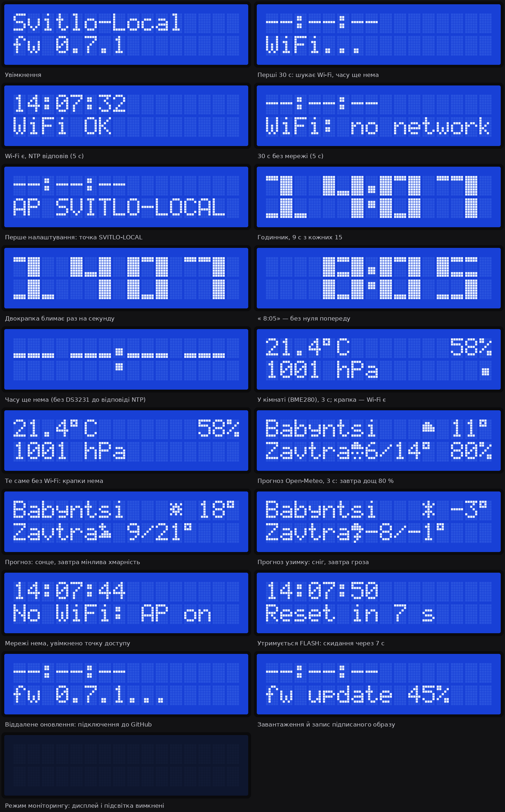
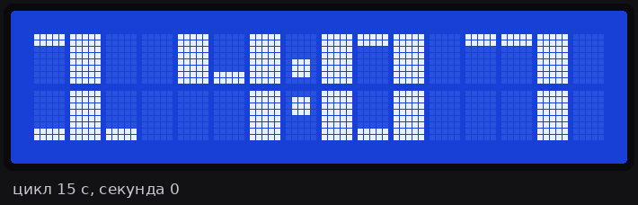
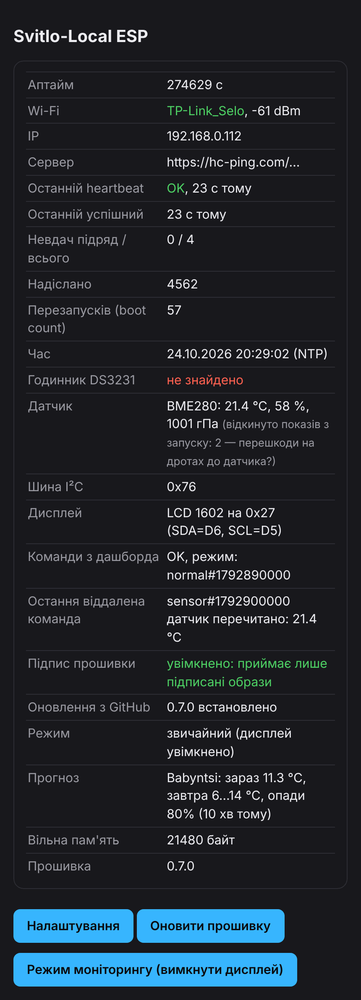
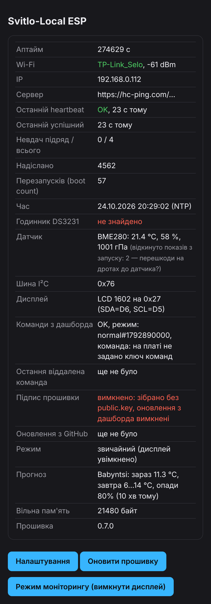
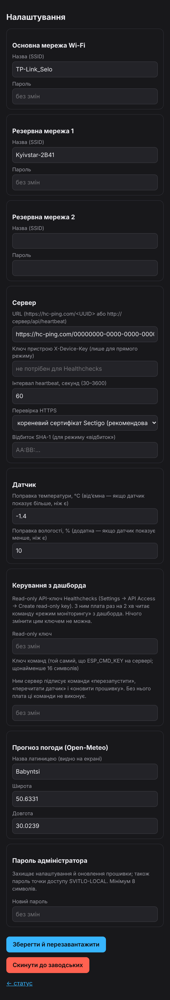
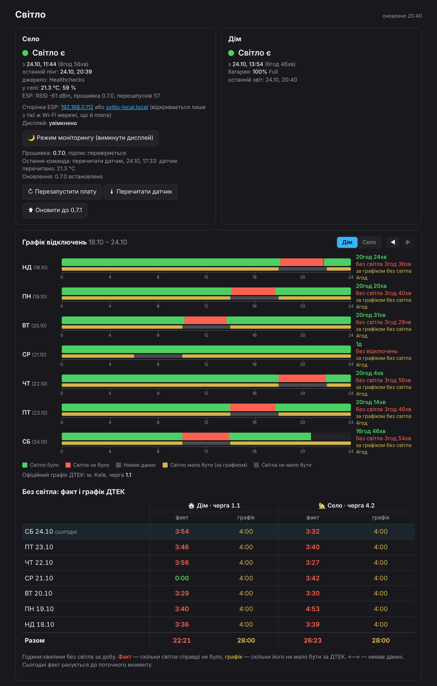

# Svitlo-Local

Власний моніторинг світла без хмари СвітлоБот: **село** (ESP8266 у розетці) і **дім** (ноутбук-сервер Proxmox).
Clean room: зроблено лише за власною специфікацією, без коду SvitloBoard.

## Як це працює

```
 СЕЛО                              ІНТЕРНЕТ                         VPS (Німеччина)
 ESP8266 ──HTTPS пінг раз/хв──▶ hc-ping.com (Healthchecks) ◀──опитує API раз/хв── svitlo-poller ─┐
 (та сама розетка, що й роутер)                                                                   ├─ SQLite
                                                                                   svitlo-web ◀───┘
 ДІМ                                                                               10.0.0.1:3003
 ноутбук pve: power-guard ──POST /api/power раз/30 с── WireGuard (лише 10.0.0.1) ──▶ (тільки через WG)
```

- **Ніде не відкрито жодного нового порту.** ESP і ноутбук тільки ходять назовні. Дашборд слухає лише WireGuard-адресу VPS.
- **Село.** Світло є, поки ESP живий і пінгує. Пінгів нема довше 3 хв: «немає сигналу, ймовірно, нема світла».
- **Дім.** power-guard на хості Proxmox читає зарядку (`ADP1/online`) і батарею (`BAT1`).

## Склад репозиторію

| Тека | Що це |
|---|---|
| `server/` | Веб і опитувач (Python, FastAPI, SQLite) у Docker Compose на VPS |
| `power-guard/` | Сервіс для Proxmox-хоста: стежить за зарядкою, засинає, вимикається при розряді |
| `firmware/` | Прошивка NodeMCU (ESP8266): пінг, точка налаштування, LCD, BME280, DS3231 |
| `tools/emulator.py` | Емулятор ESP і power-guard для тестів без заліза |
| `tools/lcd_preview.py` | Картинки екранів LCD 1602 прямо з `display.cpp` (потрібен Pillow) |
| `docs/` | Картинки: LCD, сторінки плати, дашборд |
| `tests/` | Юніт-тести машин станів і API |

## Як це виглядає

### LCD 1602 на платі

Усі екрани прошивки 0.7.0 (`docs/lcd/`). Їх малює `python tools/lcd_preview.py`: логіка екранів перенесена з `display.cpp`, а власні символи й іконки погоди читаються з самого `display.cpp`, тож після змін у дисплеї картинки варто перегенерувати.



Цикл 15 с: 9 с годинник, 3 с кімната (BME280), 3 с прогноз Open-Meteo.



### Сторінки плати

HTML з справжнього `web.cpp`, зібраного на ПК з заглушками замість ESP8266; значення вигадані, UUID — нулі (`docs/esp/`).

| Статус | Статус без підпису прошивки | Налаштування |
|---|---|---|
|  |  |  |

### Дашборд

Знімки на вигаданих даних (`docs/dashboard/`).



| Стан | Знімок |
|---|---|
| Графік «Село»: жовте — світло було без зв'язку, штрихи — можливе відключення за ДТЕК | [02-village-week.png](docs/dashboard/02-village-week.png) |
| Картка «Село» з віддаленим керуванням платою | [03-esp-remote-control.png](docs/dashboard/03-esp-remote-control.png) |
| Команду «оновити до 0.7.1» надіслано, плата ще не виконала | [04-esp-command-sent.png](docs/dashboard/04-esp-command-sent.png) |
| Село: немає сигналу | [05-village-offline.png](docs/dashboard/05-village-offline.png) |
| Дім: сервер спить | [06-home-sleeping.png](docs/dashboard/06-home-sleeping.png) |
| Дім: вимкнувся через розряд | [07-home-off.png](docs/dashboard/07-home-off.png) |
| Кімната й надворі за тиждень | [08-room-and-outdoor-week.png](docs/dashboard/08-room-and-outdoor-week.png) |
| Телефон (390 px) | [09-mobile.png](docs/dashboard/09-mobile.png) |

## Встановлення

### 1. Сервер на VPS
1. Скопіювати `server/` на VPS у `~/svitlo-local` (`scp` або tar через ssh).
2. `cp .env.example .env && chmod 600 .env` і заповнити поля (пояснення є в самому файлі).
3. `docker compose up -d --build`

**Готово, коли** `curl http://10.0.0.1:3003/api/status` з ПК через WireGuard повертає JSON.

Бекап: `svitlo-backup.sh` щоночі о 04:30 (cron) кладе перевірений знімок у `~/backups/svitlo-local`, зберігаються 14 останніх.

### 2. WireGuard pve → VPS
- На pve: `apt install wireguard-tools`, ключ у `/etc/wireguard/wg-svitlo.key`, конфіг `/etc/wireguard/wg-svitlo.conf`, `AllowedIPs = 10.0.0.1/32`. Через тунель іде лише VPS, решта трафіку йде як завжди.
- На VPS: `sudo ./wg-add-pve-peer.sh <публічний ключ pve>` додає пір (pve отримав 10.0.0.6).
- `systemctl enable --now wg-quick@wg-svitlo`

**Готово, коли** `ping 10.0.0.1` з pve відповідає.

### 3. power-guard на Proxmox-хості
1. Скопіювати `power-guard/` на хост, виконати `./install.sh` від root.
2. У `/etc/power-guard.conf` вписати `TOKEN`: сам токен. На VPS у `.env` лежить лише його sha256 (`POWER_KEY_SHA256`).
3. `journalctl -u power-guard -f`: має бути `event guard_start`.

**Готово, коли** у дашборді «Дім» показує «Світло є» і відсоток батареї.

Кришка ноутбука: потрібно `HandleLidSwitch=ignore`. На pve це вже стоїть у `/etc/systemd/logind.conf`, тому `install.sh` нічого не міняє. Якщо там цього нема, він кладе окремий файл `/etc/systemd/logind.conf.d/svitlo-lid.conf`. Видалите файл, і все повернеться як було.

## Прошивка ESP8266 (NodeMCU)

Збірка і прошивка через PlatformIO (`pip install platformio`), з теки `firmware/`:
```
python -m platformio run -t upload --upload-port COM16     # по USB
python -m platformio run -e ota -t upload                  # по Wi-Fi, кабель не потрібен
```
Для прошивки по Wi-Fi скопіюйте `secrets.ini.example` у `secrets.ini` (він не потрапляє в git) і впишіть адресу плати (`svitlo-local.local` працює в будь-якій мережі) та пароль адміністратора. Символ `%` у паролі пишеться як `%%`. Прошивка йде через сторінку плати `/update`; туди ж можна завантажити `.bin` вручну з браузера.
Перший запуск: плата піднімає Wi-Fi **SVITLO-LOCAL** (без пароля), сторінка налаштувань `http://192.168.4.1/settings`.
Туди вписуються до 3 мереж Wi-Fi, URL `https://hc-ping.com/<UUID>`, пароль адміністратора (≥8 символів).
Далі сторінка статусу — `http://svitlo-local.local/` або IP з роутера; налаштування — `/settings` (логін `admin`), оновлення прошивки — `/update`.

- Немає жодної відомої мережі 1 хв → знову вмикається SVITLO-LOCAL (з паролем адміністратора), плата далі шукає мережі.
- Плата підключається до **найсильнішої з відомих** мереж, які бачить (а не строго «основна → резервні»).
- **Скидання до заводських:** утримувати кнопку **FLASH** на NodeMCU 10 с (на LCD `Hold N s`, потім `Release FLASH`), відпустити й протягом 5 с натиснути ще раз (`Press FLASH again`); або кнопка на сторінці `/settings`. Саме утримання з 0.8.7 нічого не скидає: 25.10.2026 USB-перетворювач після закриття порту тримав GPIO0 низько, і плата сама стерла налаштування (відновлено з дампу флешу, див. нижче). Раніше це були «4 швидкі вмикання», але мигання мережі після аварії (АПВ) могло саме стерти налаштування в селі (з 0.6.0 прибрано).
- Немає відомої мережі, точка SVITLO-LOCAL увімкнена → на LCD раз на 15 с `No WiFi: AP on`.
- POST-запити (`/settings`, `/reset`, `/display`) з чужим `Origin`/`Referer` плата відхиляє (403): інакше сторінка з іншого сайту в тій самій мережі могла б скористатися запам'ятованим у браузері паролем. `/update` (стандартний ESP8266HTTPUpdateServer) так не перевіряється.
- Пінг раз на 60 с, тіло: `uptime_s`, `boot_count`, `rssi`, `fw`, а також `t`, `h`, `p` з датчика. Після невдачі — повтор через 15 с.
- Плата **не перезавантажується** через відсутність інтернету: інакше зламалось би розрізнення «світло було, не було зв'язку» за `uptime_s`.
- HTTPS: за замовчуванням перевірка кореневого сертифіката Sectigo E46 (до 2038 р.), також «відбиток SHA-1» або «без перевірки».

Світлодіод: швидко блимає — нема Wi-Fi; подвійне блимання — лише точка налаштування; раз на секунду — Wi-Fi є, пінг не пройшов; короткий спалах раз на 5 с — все добре.

### Модулі (необов'язкові, без них плата працює)

| Модуль | Піни NodeMCU | Живлення |
|---|---|---|
| BME280 (температура, вологість, тиск) | SDA=D2, SCL=D1 | 3V3 |
| DS3231 (годинник з батарейкою) — **у зібраному корпусі не встановлено**, не помістився | SDA=D2, SCL=D1 (та сама шина) | 3V3 |
| LCD 1602 з I²C-модулем PCF8574 | SDA=D6, SCL=D5 (окрема шина) | VIN (5 V) |

- LCD на окремих пінах, бо I²C-модуль може підтягувати лінії до 5 V, а BME280 — 3,3-вольтовий.
- DS3231 тримає UTC; при старті плата бере час з нього, NTP раз на годину його підводить. CR2032 у ZS-042 безпечна лише при живленні 3V3.
- **Зараз DS3231 у корпусі немає** (фізично не вліз). Тому після кожного ввімкнення годинник показує `--:--`, доки не з'явиться інтернет і не відповість NTP (зазвичай кілька секунд після підключення до Wi-Fi). Пінги від цього не залежать: дати сертифіката до відповіді NTP перевіряються відносно дати прошивки. Якщо DS3231 колись додати, прошивка підхопить його без змін.
- Температура на сервері записується раз на 5 хв (графік «Село: температура в кімнаті й надворі» на дашборді).
- Температура надворі: poller раз на 30 хв бере погодинні значення з Open-Meteo для `OUTDOOR_LAT`/`OUTDOOR_LON` у `.env` (за замовчуванням смт Бабинці; порожній `OUTDOOR_LAT` вимикає). Це модельні дані для клітинки ~2 км, а не метеостанція. На графіку пунктир на тій самій шкалі, що й кімната; у підказці видно різницю.
- BME280 тримайте на дротах подалі від плати — ESP гріє його на 1–3 °C.
- LCD: великий годинник ГГ:ХХ на обидва рядки, потім погода в кімнаті й прогноз. Крапка Wi-Fi — лише на екрані погоди (є крапка — Wi-Fi є); словами стан Wi-Fi показується лише 5 с після ввімкнення.
- Неправдоподібні покази (тиск поза 300–1100 гПа, вологість рівно 0 або 100 %, два виміри підряд не збігаються) плата відкидає й через хвилину заново підключає датчик (перечитує його калібрування). Лічильник відкинутих — у рядку «Датчик» на сторінці плати й `sbad` у пінгу. Шина I²C працює на 50 кГц. Так було 24.10.2026: після подовження дротів датчик видавав 25,9 °C, вологість 0/100 % і не мав тиску; допомогло перепаяти й закріпити дроти.
- Поправка температури: у налаштуваннях плати, за замовчуванням −1,4 °C (цей BME280 завищував на 1,3–1,5 °C). Вологість датчик перераховує з урахуванням поправки.
- Поправка вологості: там само, за замовчуванням +10 % (цей BME280 занижував приблизно на 10 %).
- Режим моніторингу: дисплей і підсвітка вимкнені, усе інше (пінги, датчик, звіти) працює. Вмикається кнопкою на дашборді (картка «Село») або на сторінці ESP; переживає вимкнення світла. Дашборд пише рядок `svitlo-mode=monitor#<час>` в опис перевірки Healthchecks (повним ключем з VPS), а плата раз на 2 хв читає його **read-only** ключем (поле «Керування з дашборда» в налаштуваннях плати). Нових портів не відкрито.
- На дашборді є посилання на сторінку ESP (IP приходить у пінгу); відкривається лише з тієї ж Wi-Fi мережі, що й плата.
- Прогноз погоди: Open-Meteo (без ключа), за замовчуванням смт Бабинці (50.6331, 30.0239), місце змінюється в налаштуваннях плати. Оновлюється раз на 30 хв, **по звичайному HTTP** (з 0.8.7: HTTPS до Open-Meteo був піком пам'яті й валив Wi-Fi-драйвер, див. «Пам'ять і HTTPS»). Цикл екранів 15 с: 9 с годинник, 3 с погода в кімнаті, 3 с прогноз (`Babyntsi ☁ 11°` / `Zavtra ☂ 12/13° 93%` — відсоток показується від 20 %). HTTPS до api.open-meteo.com перевіряється за коренями Let's Encrypt (ISRG X1/X2); якщо прогноз не отримано, екран просто пропускається.
- Нічого не видно на LCD при увімкненій підсвітці — покрутіть синій потенціометр контрасту.

## Віддалене керування платою (з Києва)

Перезапуск, «перечитати датчик» і оновлення прошивки — кнопками на дашборді, **без жодного відкритого порту** ні на VPS, ні в селі. Плата сама раз на 2 хв читає команду з опису перевірки Healthchecks (read-only ключем), прошивку сама завантажує з GitHub Releases.

```
дашборд (лише WireGuard) ──▶ VPS підписує команду ESP_CMD_KEY ──▶ опис перевірки Healthchecks
                                                                        ▲ раз на 2 хв
ESP у селі ─────────────────────────────────────────────────────────────┘
   └─ «ota:0.7.1»: перезапуск → github.com/…/releases/download/v0.7.1/firmware.bin.signed
      → перевірка RSA-підпису → лише тоді перемикається на новий образ
```

Два замки, незалежні один від одного:
- **Команди підписані HMAC-SHA256** ключем `ESP_CMD_KEY` (є лише в `.env` на VPS і в налаштуваннях плати). Хто вкраде API-ключ Healthchecks, команду не підробить. Кожна команда несе час; виконана або старша за добу не повторюється.
- **Прошивка підписана RSA-2048.** `private.key` існує лише на ПК Романа; у прошивку вшито `public.key`. Навіть повний доступ до VPS, GitHub або мережі не дає залити чужу прошивку. Підпис перевіряється і для сторінки `/update`.

| Що вкрадено | Що можна зробити |
|---|---|
| API-ключ Healthchecks | нічого з командами (немає `ESP_CMD_KEY`) |
| VPS цілком | перезапускати плату й перечитувати датчик; прошити — ні |
| Пароль адміністратора плати | змінити налаштування з мережі села; прошити — ні |
| `private.key` | усе: тому він лише на ПК, із зашифрованою копією |

**Скидання до заводських віддалено нема свідомо:** після нього плата в селі стала б відкритою точкою SVITLO-LOCAL, і налаштувати її нікому. Лише кнопка FLASH (10 с) на місці.

### Один раз: налаштування

Покроковий чекліст з перевіркою: [docs/remote-setup.md](docs/remote-setup.md).

1. На своєму ПК, у `firmware/`: `python make_keys.py` (потрібен `pip install cryptography` або openssl з Git for Windows). З'являться `private.key` (у git не потрапляє, зробіть зашифровану копію) і `public.key` (закомітити).
2. Ключ команд: `python -c "import secrets;print(secrets.token_urlsafe(32))"`. Вписати в `.env` на VPS як `ESP_CMD_KEY=...`, перезапустити `docker compose up -d`.
3. Зібрати й прошити 0.7.0 **по USB** (`python -m platformio run -t upload --upload-port COM16`): перша прошивка з перевіркою підпису, кабель — найнадійніше.
4. На сторінці плати `/settings` → «Ключ команд» — той самий рядок, що в `ESP_CMD_KEY`. На головній сторінці плати має бути «Підпис прошивки: увімкнено».

### Кожна нова версія

1. Підняти `FW_VERSION` у `platformio.ini`, `python -m platformio run`. Після збірки поруч з `firmware.bin` з'явиться `firmware.bin.signed` (підписує `signing.py`, якщо `private.key` на цьому ПК).
2. Створити реліз `v<версія>` на GitHub і прикріпити файл **саме з назвою** `firmware.bin.signed` (можна поруч і звичайний `.bin`).
3. На дашборді в картці «Село» з'явиться «⬆ Оновити до <версія>» (лише для релізів, де є підписаний файл). Плата виконає за ~2 хв; результат видно там же («Оновлення: 0.7.1 встановлено»).

- Нову версію спершу перевіряйте на платі вдома (або на другій NodeMCU). Запасна прошивка (нижче) рятує від більшості помилок, але не від усіх. Підпис захищає від чужої прошивки, а не від власної помилки.
- Невдале завантаження (немає мережі, обірвалось, підпис не той) нічого не ламає: плата лишається на старій версії і пише причину.
- Локальна прошивка `pio run -e ota -t upload` сама відправляє `.signed`, якщо є `public.key`.

### Запасна прошивка й автовідкат (з 0.8.0)

ESP8266 не вміє тримати дві готові до запуску прошивки, як марсохід: завантажувач завжди стартує з початку флешу. Тому плата тримає **запасну копію** перевіреної версії файлом у LittleFS (`/golden.bin`, ~580 КБ із 1000 КБ) і в разі біди сама «оновлюється» з нього.

- Нова версія (з GitHub, через `/update` чи по USB) спершу **на перевірці**. Вона підтверджується, щойно пінг отримав HTTP 200 і плата прочитала команди з дашборда; зазвичай це перша хвилина.
- **Не підтвердилась за 15 хв** (наприклад, не підключається до Wi-Fi) або **3 старти поспіль упала** → плата копіює запасну назад і перезапускається. На дашборді: «Оновлення: 0.8.1 не підтвердилась (…), повернуто запасну 0.8.0».
- Запасна сама не змінюється. Найперша версія з цією функцією зберігає себе сама. Далі кнопка **«💾 Зробити <версія> запасною»** на дашборді (команда `golden`), коли нова версія попрацювала й нею задоволені.
- Чого автовідкат не врятує: прошивки, яка падає ще до `goldenBoot()` на старті або ламає саму перевірку. Цей код маленький і змінюється рідко.
- Чому файл, а не вільний флеш за прошивкою: сторінка `/update` резервує під новий образ увесь вільний простір і записує його одразу за поточною прошивкою. Першу «сиру» копію вона так і затерла (тест 24.10.2026).
- Тестові збірки для перевірки відкату (лише локально, у реліз не викладати): `-DSVITLO_TEST_CRASH` (падає одразу після старту) і `-DSVITLO_TEST_NO_WIFI` (не підключається до мереж), наприклад `PLATFORMIO_BUILD_FLAGS="-DSVITLO_TEST_CRASH" python -m platformio run -e ota -t upload` з тимчасовою версією на кшталт `0.8.0.1`. Обидва сценарії перевірено на платі в селі 24–25.10.2026.

### Пам'ять і HTTPS

Кожне HTTPS-з'єднання (BearSSL) потребує одного суцільного буфера ~16,7 КБ: наші сервери не приймають меншого розміру TLS-фрагмента (MFLN). Вільної пам'яті ~27 КБ. Поки кожен модуль розбирав свої кореневі сертифікати при першому запиті, вони опинялись посеред пам'яті. Після першого прогнозу суцільного шматка 16,7 КБ уже не лишалось: усі запити падали з `connection failed`, а згодом сам Wi-Fi-стек падав на виділенні пам'яті (Exception 29 в `ieee80211_setup_ratetable`, перезапуски кожні кілька хвилин). Тепер сертифікати розбираються один раз на самому початку старту (`trust.cpp`). Найбільший вільний блок видно в пінгу (`blk`) і в лозі.

Нічний лог 25.10.2026 показав, що падіння лишились і з достатньою пам'яттю у простої: Exception 29 майже рівно кожні 30 хв, тобто на кожному оновленні прогнозу. HTTPS до Open-Meteo (ланцюжок Let's Encrypt з коренем RSA-4096) був найважчим запитом плати, і під час нього Wi-Fi-драйверу не вистачало пам'яті. З 0.8.7 прогноз іде по HTTP, корені Let's Encrypt не тримаються в пам'яті: у простої вільно ~31,6 КБ замість ~27,7 КБ. Режим 802.11g (0.8.2) не допоміг, а роутер у селі ще й працює в режимі «802.11n only» і 11g-клієнтів не пускає, тож з 0.8.6 прошивка явно ставить b/g/n.

### Wi-Fi: прив'язка до точки доступу (з 0.8.6)

- У мережі села дві точки з однією назвою: роутер і ретранслятор. Плата сама обирає найсильнішу й може опинитися на ретрансляторі. На сторінці плати видно, до якої точки вона підключена («Точка Wi-Fi (BSSID)») і які точки бачить.
- Налаштування «Прив'язка до точки доступу» (`bssid`): плата підключається лише до цієї точки. Якщо її не видно 5 хв, підійде будь-яка точка налаштованих мереж, щоб плата не лишилась без зв'язку, якщо роутер замінили.
- Сторожовий таймер: якщо основний цикл стоїть 3 хв, плата перезапускається. Інакше завислий виклик тримав би нову версію «на перевірці» назавжди.

### Робота з платою по USB

Скрипт `tools/serial_log.py COM16 300` читає лог, тримаючи DTR/RTS відпущеними. На NodeMCU ці лінії керують GPIO0 (FLASH) і EN. Кабель відключати, поки скрипт ще працює. Якщо налаштування все ж стерлись, їх можна дістати з флешу: `esptool.py read_flash 0x300000 0xFA000 fs.bin` (LittleFS не затирає видалене одразу), знайти в дампі `{"v":`, покласти знайдений `config.json` у тимчасову папку й залити `PLATFORMIO_DATA_DIR=<папка> pio run -t uploadfs` (запасна копія при цьому зникає, плата збереже нову сама). Дамп містить паролі: одразу видалити.

## Звірка з офіційними графіками ДТЕК

- Джерело — [Baskerville42/outage-data-ua](https://github.com/Baskerville42/outage-data-ua) (MIT): бот кожні кілька хвилин копіює погодинні графіки з сайтів ДТЕК у `data/<регіон>.json`. Береться блок `fact` (графік на сьогодні і, ввечері, на завтра).
- Черги (у `.env` на VPS, формат `регіон:група`):
  - дім — `SCHEDULE_HOME=kyiv:GPV1.1` (м. Київ, просп. Червоної Калини 54/9, черга 1.1 за сайтом ДТЕК Київські електромережі);
  - село — `SCHEDULE_VILLAGE=kyiv-region:GPV4.2` (Київська обл., черга 4.2).
- Опитувач завантажує файли раз на 15 хв (з ETag, тож без змін — без повторного завантаження) і зберігає графік кожного дня в таблицю `schedule_days`. Якщо графік протягом дня змінюють, лишається остання версія.
- Дашборд: смуги за днями (факт згори, графік ДТЕК тонкою смугою під ним; перемикач Дім/Село), а під ними таблиця «Без світла: факт і графік ДТЕК» — по рядку на день, колонки Дім (факт / графік) і Село (факт / графік), години:хвилини без світла, внизу «Разом» за тиждень. Стрілками ◀ ▶ — попередні тижні.
- Обмеження: це дзеркало, не API ДТЕК. Якщо воно перестане оновлюватись, на дашборді біля черги видно дату останнього оновлення. Дні, за які графік не встигли зберегти, лишаються без смуги графіка.

## Поведінка ноутбука без світла (power-guard)

| Стан | Що відбувається |
|---|---|
| NORMAL | Зарядка є, звіт раз на 30 с |
| ON_BATTERY | Зарядка зникла: одразу подія «світло вдома зникло», ноутбук працює як UPS |
| Сон | Одразу, щойно зникла зарядка: `rtcwake -m mem -s 300`. Прокидається кожні 5 хв на ~6 с: перевіряє зарядку, надсилає звіт, щойно роутер пропускає пакети (~5,5 с після пробудження), і знову спить. Без мережі чекає щонайбільше 8 с (`NET_WAIT_S`), звіт лишається в черзі. Скільки ноутбук не спав, видно в події `sleep_start` (`awake_s`) |
| Розряд | При ≤7%: штатний `systemctl poweroff` із записом у журнал |

- **Чому `rtcwake`, а не `systemctl suspend`.** На pve `systemctl suspend` дає «Access denied», і ми це не обходимо. Підключення зарядки ноутбук не будить, Wake-on-LAN нема, тому працює лише таймер.
- **Точність.** Якщо світло повернулось під час сну, power-guard дізнається про це тільки при пробудженні. Тому час появи світла вдома має точність до 5 хв (у журналі «точність ±5 хв»).
- **Після повного розряду** ноутбук вмикається лише кнопкою: BIOS не вміє вмикатися сам. Дашборд на VPS показує банер «потрібен ручний запуск».
- **Журнал** лежить у `/var/lib/power-guard/journal.jsonl` (тільки дописується) і переживає перезавантаження. Неотримані сервером події чекають у `outbox.json` і надсилаються пізніше.
- `KEEP_AWAKE=true` вимикає сон взагалі.
- **Швидкість розряду у сні.** Кожна подія «сервер прокинувся» містить `drain_pct_per_h`. За нею підбирається `WAKE_INTERVAL`.
- **Чому раніше було ~10 с, а не 8 (вимір 26.10.2026).** Зв'язок мережевої карти з'являється через 2,6 с після пробудження, а роутер пропускає пакети лише через ~5 с. WireGuard шле handshake ще до появи зв'язку, губить його і пробує знову лише через 5 с, тож тунель піднімався на ~7,8 с. Тоді ноутбук не спав ~8,5 с, а без мережі ~13 с (ще одна спроба з тайм-аутом 5 с перед сном). Тепер power-guard чекає зв'язку карти, а перед кожною короткою спробою (0,8 с) перестворює пір WireGuard (`WG_IFACE`, `wg showconf | wg setconf`), бо новий пір шле handshake одразу. Звіт іде на 5,6–5,8 с (два контрольні сни по 20 с). Окремий `sync` прибрано: ядро синхронізує диски саме перед сном. Менше ~5,5 с не вийде: стільки потрібно роутеру.
- **Після аварійного перезавантаження** перші цикли можуть тривати хвилину й довше (26.10: 76 с і 54 с). Тоді контейнери ще монтують свої диски: ext4 з MMP чекає, і синхронізація дисків перед сном чекає разом з ним. Це лише після падіння.
- **AdGuard і NAS засинають разом з ноутбуком.** Тому в роутері як запасний DNS стоїть 1.1.1.1, інакше під час сну в квартирі «зникне інтернет».

## Чесні прогалини (що система НЕ може розрізнити)

Пінгів із села нема, а сервер працює. Причини можуть бути такі: (а) у селі нема світла; (б) світло є, але впав інтернет чи роутер; (в) завис ESP.
Тому дашборд пише «Немає сигналу — ймовірно, нема світла», а не «точно нема світла».

Що допомагає розрізнити:
- ESP передає в тілі пінгу свій `uptime_s`. Якщо після перерви ESP **не перезапускався** (uptime більший за перерву), то світло було весь час, а не було лише зв'язку. Така подія позначається «зв'язок відновився (світло було)».
- Справжній момент появи світла дорівнює часу першого пінгу мінус `uptime_s`. Роутер вмикається 1–2 хв, і ця затримка так компенсується.
- Якщо дані могли загубитися, проміжок позначається **«невідомо»**, а не «відключення». Таке буває, коли VPS лежав довше 100 хв і Healthchecks уже витіснив старі пінги. Перевіряється це за безперервністю номерів пінгів `n`.

## Ризики Healthchecks
- Сервіс бачить час відключень і IP сільського роутера.
- **UUID перевірки — це секрет.** Хто його знає, може слати фальшиві пінги. Не публікуйте його.
- **API-ключ повний, не read-only.** Тіла пінгів (`uptime_s`) read-only ключ не віддає. Ключ лежить в окремому проєкті Healthchecks лише з цією перевіркою, тож у гіршому разі з ним можна зіпсувати тільки її.
- Безкоштовний план зберігає 100 останніх пінгів, тому повна історія зберігається лише в нашій базі.

## Тести

```
cd tests
python -m unittest
```

Без FastAPI тест API пропускається, решта працює на чистому Python.

## Діагностика

| Симптом | Де дивитись |
|---|---|
| «Дім: немає даних» | `ssh root@192.168.10.50 journalctl -u power-guard -n 50`, `wg show wg-svitlo` (є handshake?) |
| «Фоновий збирач не працює» | на VPS: `cd ~/svitlo-local && docker compose logs --tail 50 poller` |
| «Healthchecks недоступний» | текст помилки видно в картці «Село»; 401/403 означає неправильний ключ |
| Бекап | `~/svitlo-local/backup.log` |
